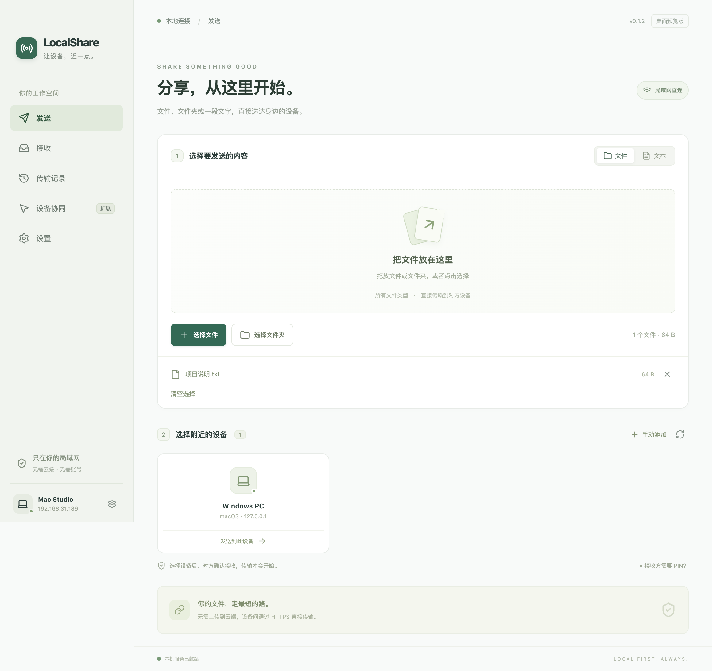
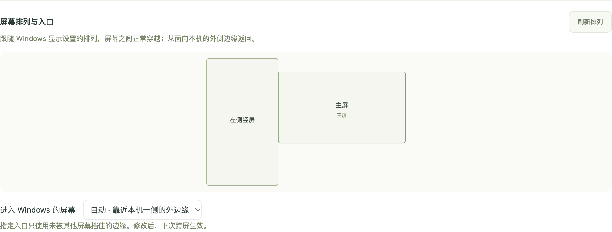
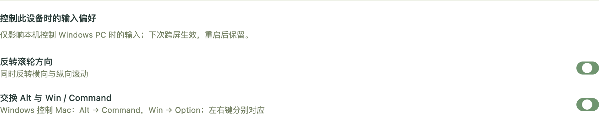

# LocalShare

Electron + Bun 的局域网共享桌面应用。中文界面，面向 macOS 与 Windows。

参考 [LocalSend 源码](https://github.com/localsend/localsend)和 [v2 协议](https://github.com/localsend/protocol)，独立实现传输核心，并加入可信设备协同。

[下载安装包](https://github.com/okbug/localshare/releases) · [源码仓库](https://github.com/okbug/localshare)

**0.1.5 新增手动键鼠远控，不传屏幕画面。** 在已配对设备上点击「开始控制键鼠」，无需跨屏触发；按 Ctrl+Alt+Esc（Mac Control+Option+Esc）返回。两端均需升级到 0.1.5 并开启键鼠共享。保留 Windows 多屏、Mac 居中固定、滚轮反转和 Alt / Win 交换。

**Mac 用户请使用 0.1.1 或更新版本。** 0.1.0 的 Mac 包资源签名不完整，会触发“已损坏，无法打开”；0.1.1 修复应用与原生模块签名，并增加 ZIP 解压后的严格校验。



## 功能

- 局域网自动发现、手动 IP / 端口连接、文件、递归文件夹、文本发送。
- 接收确认 / 拒绝、传输进度、取消、历史、接收位置设置、后台托盘。
- HTTPS 流式传输、持久化证书、传输前核对证书指纹、会话令牌、SHA-256 验证、同名文件不覆盖。
- 双端确认配对、文本剪贴板同步（最多 1 MiB、防回环、不记录正文）、撤销信任。
- 实验性跨屏键鼠：Windows 多显示器按系统排列移动、自动或指定入口屏幕、排列预览、Mac 居中固定并恢复位置、事件顺序、心跳断线恢复、`Ctrl + Alt + Esc` 紧急退出。

基础传输实现 LocalSend v2 上传接口；没有宣称涵盖官方所有功能。网页下载分享、断点续传、空目录、自动接收、图片/文件剪贴板、Mac 多显示器间的跨设备入口及跨设备文件拖拽不属于当前版本。LocalSend 客户端无需安装 LocalShare 即可使用基础传输协议；剪贴板和键鼠扩展需要双方安装 LocalShare。官方客户端互通尚待实机验证。

## 开发与运行

需要 Bun 1.3.5+、Node 22+。macOS 构建输入模块需要 Command Line Tools；Windows 构建输入模块需要 Visual Studio Build Tools 的 C++ 工具链（在 x64 Native Tools 命令行运行）。打包后的使用者不需要安装 Bun、Node 或开发工具。

```sh
bun install --frozen-lockfile
bun run native
bun run dev
```

`dev` 支持界面热更新；主进程或 preload 改动后重启。生产模式：

```sh
bun run build
bun run start
```

关闭窗口后继续在系统托盘 / 菜单栏运行。要退出应用，使用托盘的“退出 LocalShare”或应用菜单。

## 在 Mac 与 Windows 上使用

1. 两端打开 LocalShare 并连接同一个局域网。首次运行，按系统提示允许本地网络访问。
2. 在发送页选择文件或拖入文件夹，点击附近的设备；对方在接收页确认。
3. 自动发现不可用时，点击“手动添加”，填写对方接收页的 IP 与端口。
4. 剪贴板：在“设备协同”中配对，核对两端 6 位校验码与完整指纹，双端确认；两端都打开“文本剪贴板共享”，并打开对应设备的“文本同步”。随后新复制的文本会同步。开启时不会发送之前已经存在的剪贴板文本。
5. 键鼠：两端都开启键鼠总开关和对应设备开关。在 Mac 上将 Windows 设置到“右侧”，在 Windows 上将 Mac 设置到“左侧”。Mac 鼠标越过主屏右边缘进入 Windows；向左越过 Windows 边缘返回。反向也可从 Windows 发起。
6. 需要时按 **Ctrl + Alt + Esc**（Mac：Control + Option + Escape）恢复本机控制。断线后约 2 秒自动恢复，原生模块在父进程失去响应时也有独立超时保护。

每次启动后，剪贴板与键鼠总开关默认关闭；设备信任及左右位置保留。取消配对会撤销本机信任，并在对方在线时通知其撤销；对方离线时请在其界面也取消旧配对，再重新建立。

**系统权限与限制：** macOS 在“设备协同 → 检查权限”中查看并为应用 / `localshare-input` 授予辅助功能权限。未授权时，文件和文本剪贴板仍可使用。Windows 普通权限进程不能控制管理员权限窗口、UAC 或安全桌面。第一版按常用 Windows VK 键码映射；不同键盘布局、IME、拖动与多屏、休眠唤醒需实机回归。本机编译检查通过不等于 Mac / Windows 跨机手感验证通过。

### 键鼠共享怎么开启

**两台电脑分别打开左侧「设备协同」，以下开关两端都要开启。** 以 Mac 在左、Windows 在右为例：

| 检查项 | Mac 端 | Windows 端 |
| --- | --- | --- |
| 配对 | 与 Windows 配对并确认校验码 | 与 Mac 配对并确认相同校验码 |
| 页面上方总开关 | 打开「跨屏键盘与鼠标」 | 打开「跨屏键盘与鼠标」 |
| 下方「已配对设备」 | Windows 卡片中打开「共享键鼠」 | Mac 卡片中打开「共享键鼠」 |
| 对方位于本机的哪一侧 | Windows 设为「右侧」 | Mac 设为「左侧」 |
| 系统权限 | 点「检查权限」，允许辅助功能权限，再返回开启总开关 | 总开关开启后应保持打开；若自动关闭，查看输入模块错误提示 |

配置后，继续将鼠标推过 Mac **主屏幕右边缘**即可进入 Windows，向左越过 Windows 的屏幕边缘返回。Windows 紧急退出为 Ctrl + Alt + Esc，Mac 为 Control + Option + Esc。

**重启任一端的应用后，都要重新打开该端的总开关。** 设备卡片中的授权及左右位置会保留。升级后 Mac 若无法完整捕获键盘/鼠标，请检查「辅助功能」与「输入监控」中 LocalShare / localshare-input 的授权，完全退出后重新打开。

正常跨入对方设备后，本机鼠标应锁定并隐藏，本机程序不应同时收到点击和键盘输入。0.1.2 要求原生模块确认截获成功才建立会话；失败会恢复本机控制。Windows 如提示输入注入被系统拒绝，请先在普通权限的记事本/桌面中测试；普通权限进程无法控制管理员窗口或安全桌面。

修饰键按当前物理键位映射：Mac 的 Control → Windows Ctrl、Option → Alt、Command → Windows 键。在 Windows 中复制/粘贴请使用 Mac 键盘的 Control+C / Control+V；反向操作 Mac 时，Windows 键对应 Command。不同布局及输入法仍需实测。

### Windows 多屏与 Mac 光标固定（0.1.4）

Windows 的屏幕位置直接跟随「设置 → 系统 → 显示」。支持副屏在左、右、上、下以及错位、竖屏和负坐标；屏幕间的实际相接区域可以穿越，空白区域不会被当成屏幕。复制模式重合的显示区域按一个桌面区域处理。Windows 需要支持 Per-Monitor V2 的 Windows 10 1703 或更新版本。

例如排列为 `Mac | Windows 副屏 | Windows 主屏`：从 Mac 向右进入副屏，继续向右进入主屏；从主屏向左先回副屏，继续越过副屏最左侧才返回 Mac。

在 **Mac → 设备协同 → Windows 设备卡片 → 屏幕排列与入口** 可预览排列。默认「自动」从靠近 Mac 一侧的有效外边缘进入；也可选择具有可用入口边缘的屏幕。修改在下次跨屏生效；选中的屏幕被拔掉或其入口被别的屏幕完全挡住后，刷新会恢复自动。读取布局失败时可点「恢复自动入口」，避免旧选项阻止连接。



显示器插拔、排列或分辨率改变时，正在进行的控制会先结束并释放按键；重新跨屏使用新布局。Windows 自有屏幕的上下排列可用；跨电脑摆放目前仍配置左/右。

Mac 控制 Windows 时，保存跨出时的位置，在当前屏幕中央固定并隐藏本机光标；检测到偏移时纠正，纠正失败就结束共享。正常返回、紧急退出、断线、超时和正常退出都会尝试恢复原位置。实际前后台切换、混合缩放手感和不同驱动仍需物理双机验证。

### 手动键鼠远控（0.1.5，无画面）

1. 两端配对，开启键鼠总开关，并在对方设备卡片里打开「共享键鼠」，按需授予输入权限。
2. 在控制端进入「设备协同 → 已配对设备」，点击对方卡片的 **「开始控制键鼠」**。
3. 控制端本机光标居中固定并隐藏，键盘、鼠标移动、点击和滚轮转发至对方；被控端保留原来的鼠标位置。Windows 被控端可在自身多块屏幕之间移动，碰到外边缘也不会退出手动远控。Mac 被控端目前限制在其当前光标所在的那块显示器内。
4. 按 **Ctrl+Alt+Esc**（Mac：**Control+Option+Esc**）退出，恢复控制端原来的光标位置。被控端也可使用快捷键或界面「恢复本机控制」停止。断线后约两秒自动恢复。


手动模式不依赖左右位置或跨屏入口设置；原有自动跨屏方式仍可使用，两种方式不能同时占用键鼠会话。开始前会检查对方是否支持手动模式，旧版本会提示升级，不会直接锁定本机后才发现不兼容。

**软件不采集或显示对方桌面，也不新增屏幕录制权限。** 需要直接查看对方显示器或使用已有显示方式。文件发送、文本剪贴板仍用原功能和独立开关；开启的滚轮反转与 Alt/Win 交换同样应用于下一次手动控制连接。

### 滚轮方向与 Alt / Win 交换（0.1.3）

在**发起控制的电脑**上打开「设备协同 → 已配对设备 → 对方设备卡片 → 控制此设备时的输入偏好」。两个开关独立设置，默认关闭，按设备保存，重启后保留。

- **反转滚轮方向**：横向、纵向滚动都反转。鼠标移动不受影响。
- **交换 Alt 与 Win / Command**：Windows 控制 Mac 时，Alt 对应 Command，Win 对应 Option；左右键分别对应。反向从 Mac 控制 Windows 时，开启后 Option 对应 Win、Command 对应 Alt。Control、Shift 和普通键保持原映射。

例如希望用 Windows 键盘上的 **Alt+C / Alt+V** 在 Mac 复制粘贴，就在 **Windows 的 Mac 设备卡片**里开启「交换 Alt 与 Win / Command」。不需要在 Mac 上同时开启。返回本机后系统键位保持原样；对其他设备也不会自动启用。

修改在**下一次跨屏**时生效。正在控制时，请先将鼠标移回本机，再重新进入对方屏幕；这样按键按下和松开使用同一套映射，避免修饰键卡住。紧急退出快捷键仍按本机原始物理键位识别。



如果报错 `{"error":"键鼠共享未开启"}`，说明接收控制请求的一端没有同时满足“总开关已开启”和“允许这台设备共享键鼠”。例如从 Mac 控制 Windows 时出现此错误，应检查 Windows 的总开关，以及 Windows 中 Mac 设备卡片的「共享键鼠」。这两个开关任意一个关闭都会拒绝请求。新的主分支已将报错细分为具体设备和具体开关；0.1.0 / 0.1.1 安装包仍显示旧提示，按本节步骤开启即可。

## 网络排障

- 默认 TCP 与 UDP 端口为 **53317**，允许应用在专用局域网接收连接。Windows 将当前家庭网络设为“专用”。
- 路由器访客网络 / AP 隔离、VPN 的禁止局域网选项可能阻止设备互通。
- 本机与 LocalSend 同时运行可能占用相同 TCP 端口。可先退出另一应用，或为 LocalShare 选择其他端口；UDP 发现仍使用标准 53317。

macOS / Linux 临时更换端口：

```sh
LOCALSHARE_PORT=53318 bun run start
```

Windows PowerShell：

```powershell
$env:LOCALSHARE_PORT = '53318'
bun run start
```

`LOCALSHARE_DATA_DIR` 可指定独立配置目录，`LOCALSHARE_RECEIVE_DIR` 覆盖接收位置，`LOCALSHARE_ALIAS` 覆盖本机名称。仅测试使用 `LOCALSHARE_NO_DISCOVERY=1` 和 `LOCALSHARE_PORT=0`（随机可用端口）。

默认接收到“下载 / LocalShare / 会话ID”目录；目录结构保留。同名文件增加后缀，不静默覆盖。空目录与符号链接会被跳过；跨 Windows 不可用的名称会明确拒绝。

## 构建安装包

在对应平台：

```sh
bun run dist:mac
# 或在 Windows C++ 工具链命令行：
bun run dist:win
```

输出位于 `release/`。macOS 输出应用 ZIP，Windows 输出安装版与便携 EXE。原生 helper 是独立可执行文件，随安装包携带。

发布流程在 macOS 和 Windows 上分别构建安装包并运行原生自检；自检不向用户桌面注入输入。Mac 上也可用官方 Zig 交叉编译（SHA-256 校验下载）：先运行 `bun run native:win:cross`，再运行 `bunx electron-builder --win --x64 -c.win.signExecutable=false`。编译和自检通过不等于已完成真实 Windows 多屏鼠标操作验证。

GitHub Actions 包含 macOS arm64 / x64、Windows x64 原生构建任务，可手动触发或推送版本标签后构建。当前 Mac 预览版使用 ad-hoc 签名，尚未获得 Developer ID 发行签名与 Apple 公证；正式分发前应配置开发者证书。预览版安装包在本仓库的 [Releases](https://github.com/okbug/localshare/releases) 中提供。

首次打开新包时，如果系统提示无法验证开发者，可在确认下载来源为本仓库后，按照 [Apple 官方说明](https://support.apple.com/zh-cn/102445)，在“系统设置 → 隐私与安全性”中为 LocalShare 选择“仍要打开”。签名完整性校验与 Apple 公证是两个独立检查；本地 ad-hoc 签名不会消除未公证应用的首次信任提示。

## 验证

```sh
bun test
bun run typecheck
bun run build
bun run smoke
bun run smoke:displays
bun run verify:mac
# 校验实际 ZIP 的解压结果：
bun run verify:mac release/LocalShare-0.1.1-arm64-mac.zip
```

Bun 管理工具链；集成测试由 Bun 构建后在 Node 运行，使用与 Electron 一致的 TLS 行为。桌面检查也在 Node 中启动真正的 Electron，避免 Bun 与调试协议实现的差异。测试仅使用临时目录、回环地址和测试内容，不向真实网络设备发送文件。

已验证和待验证项目见 [验证记录](docs/verification.md)。方案见 [设计文档](docs/superpowers/specs/2026-11-04-localshare-design.md) 与 [执行计划](docs/superpowers/plans/2026-11-04-localshare.md)。

## 结构与协议

```text
src/core/        证书、发现、HTTPS、文件会话、配对、控制会话
src/main/        Electron 窗口、安全 IPC、托盘、剪贴板、原生模块桥
src/preload/     固定 IPC 白名单
src/renderer/    React 中文界面
native/          macOS Objective-C / Windows C++ 输入模块
tests/          真实 HTTPS 和状态机集成测试
scripts/        开发、构建、原生编译、双实例桌面检查
```

LocalSend 上传接口：`/api/localsend/v2/{info,register,prepare-upload,upload,cancel}`。LocalShare 扩展接口：`/api/localshare/v1/`，配对后使用客户端证书指纹与随机 Bearer 凭据双重鉴权。键鼠事件通过鉴权 HTTPS 长轮询传递，不落日志或历史；后续根据双机延迟数据评估改用长连接。

配对密钥和 TLS 私钥保存在系统用户配置目录，文件权限限制为当前用户；renderer 不接触它们。第一次发现属于首次信任，需在两端核对指纹，避免对未知同网设备授予共享权限。

Apache-2.0。参考项目及依赖出处见 [NOTICE](NOTICE)。
